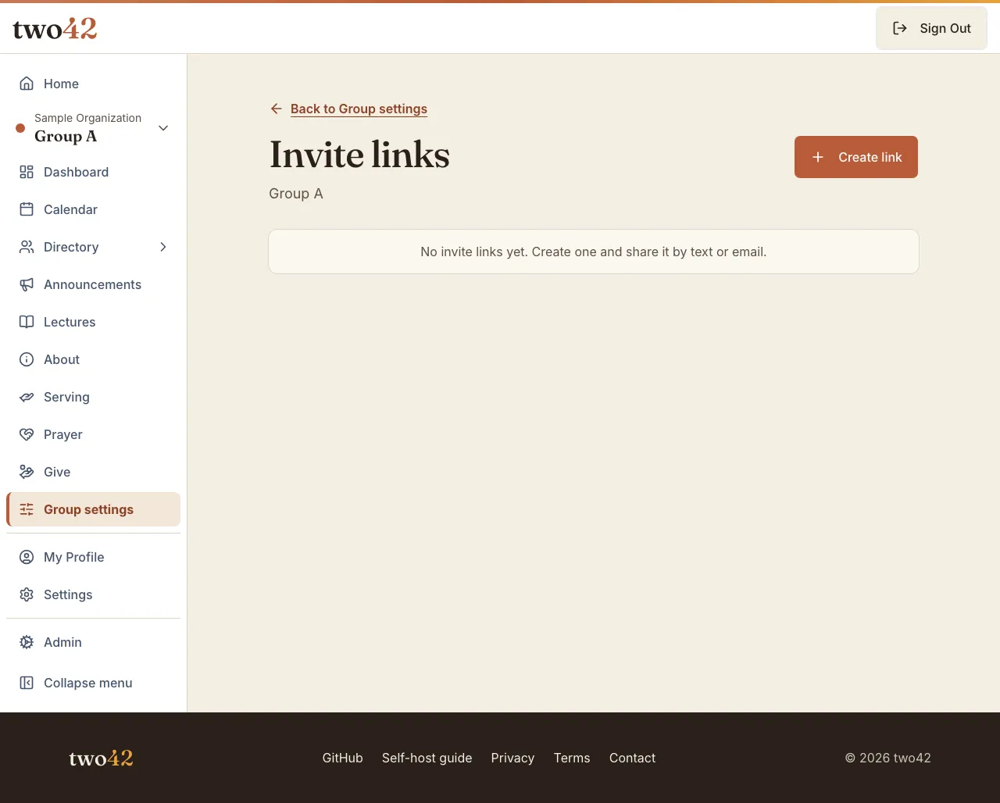
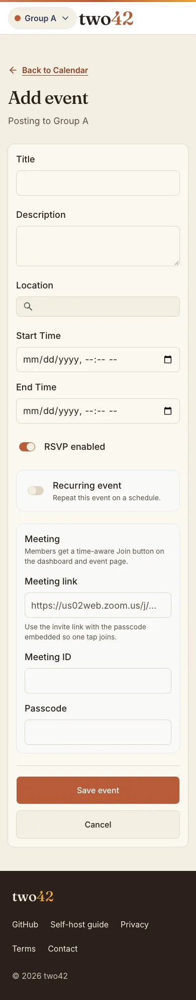
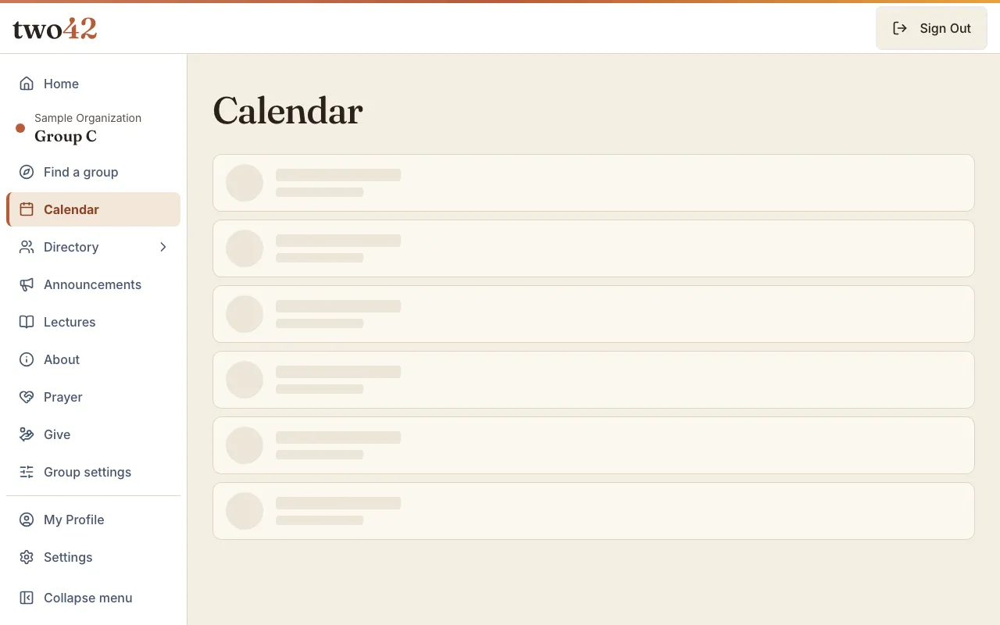
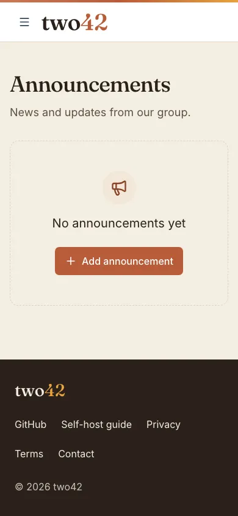
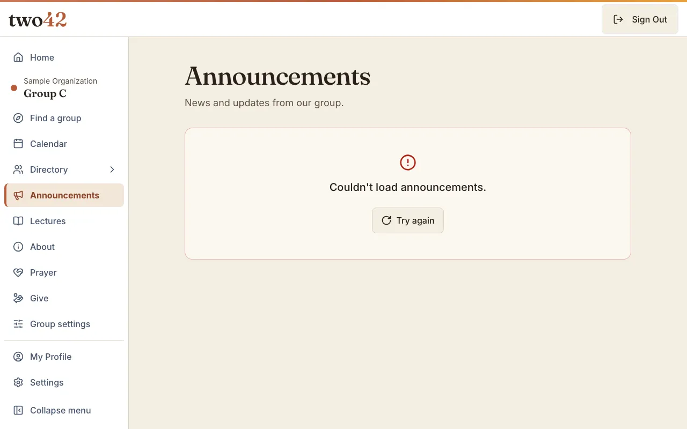

# two42 — Design System

A living design system for two42. Changes come via PR. When guidance conflicts, precedence is: the maintainer's explicit words → this document → the project's existing tokens.

---

## Brand

**Name:** two42 — always lowercase. It reads aloud as "two forty-two" → **Acts 2:42** (the early church: teaching, fellowship, breaking bread, and prayer). The reference is carried by how the name is said; there is no literal colon.

**What it is:** software for church **connection groups**. Each **church is an organization** that contains its **groups**. Open source under **AGPL-3.0** and self-hostable; the hosted service is the business. Every feature is open — nothing is gated behind a paid tier.

**Voice:** quiet and confident — plain, functional copy, verb+noun labels, one primary action per screen, nothing explained twice; no salesy subtitles or cute metaphors. Warmth is reserved for empty states and first-run moments. It is a modern product for the people in a connection group, not a tool for developers or administrators: anyone in the group should be able to use it without help, so type stays large, contrast high, and touch targets generous — without the UI feeling dated. See [Accessibility floor](#accessibility-floor).

---

## Wordmark

Canonical assets are outlined SVGs in [`public/brand/`](../../public/brand) — Fraunces converted to vector paths, so the mark never silently falls back to a system font.

- **Lockup:** `two` (lowercase word) + `42` (numeral), read together as "two forty-two."
- **The `42` is the focal element — set apart by color, not weight.** `two` and `42` share one weight (Fraunces ≈ 580, `-0.02em` tracking, display optical size); the `42` carries the accent color while `two` takes the ink color. The canonical SVGs are generated this way.
- **Typeface:** Fraunces (variable display serif, high-contrast, display optical size).

| File | Use |
|---|---|
| `two42-wordmark.svg` | Espresso `two` + Clay `42` — **light** backgrounds |
| `two42-wordmark-dark.svg` | Warm Paper `two` + Marigold `42` — **dark** backgrounds |
| `two42-mark.svg` | the `42` tile (Marigold on a Clay ground, rounded square) — favicon, avatar, app icon |

**Rules**
- Never re-typeset the wordmark in a live font — ship the SVG.
- Clearspace: keep at least the height of the `4` clear on all sides.
- Minimum wordmark width ≈ 96px; below that, use the tile.
- Don't recolor beyond the provided light/dark variants; don't stretch, skew, outline, or add effects.

---

## Typography

| Role | Typeface |
|---|---|
| Wordmark / display / headings | **Fraunces** (variable serif) — warmth + authority |
| UI / body | **Inter** (variable sans) — legible from captions to headers |
| Data / mono | **JetBrains Mono** — tabular numerals |

Fraunces and Inter load via `next/font/google`.

---

## Color

Warm and earthen — deliberately not the church-tech default blue. Four brand colors, taken directly from the "The Table" wordmark study:

| Name | Hex | Role |
|---|---|---|
| **Clay** | `#B85C38` | primary accent — primary **fills**: buttons, active-nav borders, bars, and the `42` on light grounds. Never text on a light ground (3.93:1 on Warm Paper): text uses deep clay `#8A4227` (`text-brand-primary-text`, 6.3:1 on Warm Paper, 6.8:1 on card, 6.0:1 on brand-warm). Hovered primary fills use `#A65332` (`bg-brand-primary-hover`, 5.4:1 with white text). |
| **Marigold** | `#E8A33D` | secondary highlight — fills, bars, and the `42` on dark grounds. Never text on a light ground (about 2:1): eyebrows, badges, and warnings use `#7A5411` (`text-brand-accent-text`, 5.9:1 on Warm Paper) |
| **Espresso** | `#2A211A` | ink on light grounds / dark-mode ground |
| **Warm Paper** | `#F4EEE2` | light-mode ground / text on dark grounds |

Semantic colors (success / warning / danger) are separate from these four. The destructive red `#B42318` (`--destructive`) is chosen as *text*: it holds 4.5:1 on Warm Paper (5.7:1), card (6.2:1), brand-warm (5.4:1), and on its own 10% tint over brand-warm (4.6:1), so form errors and the destructive Button variant read on every light ground. The destructive Button hovers to the solid red with white text (6.6:1), not a deeper tint: a 20% tint drops the red text to 3.9:1 on brand-warm.

Clay (the primary accent) is the one color a tenant can override (see [Theming](#theming-multi-tenant)).

---

## Theming (multi-tenant)

Tokens come in two layers.

**1. Product tokens — fixed.** Defined as CSS custom properties in `app/globals.css` (`@theme`): the Fraunces wordmark, shell chrome, structural neutrals, spacing, radii, and semantic colors. Not overridable by a tenant.

**2. Tenant tokens — per-org.** The **`organizations.branding`** (jsonb) column (Phase 1, #210) is read at runtime since Phase 3 (#212) by `lib/branding.ts`, which falls back per-key to the platform defaults — an invalid `accent` must never discard a valid `display_name`. Validation is per-key and uneven; the table records what each key actually gets:

| Key | Meaning | Validation in `resolveBranding()` |
|---|---|---|
| `display_name` | the church/group name shown within their space (tab title, email sender name) | non-empty after trim; C0/C1 control characters stripped (it reaches `From:` and `Subject:` headers) |
| `accent` | a single accent color; drives `--color-brand-primary` **and** the shadcn `--primary` / `--ring` / `--sidebar-primary` / `--sidebar-ring` | strict 6-digit hex — the CSS-injection guard for the `<style>` block and every inline `style=""` in `lib/email/*`. The `/platform` write path additionally enforces ≥ 4.5:1 contrast via `validateAccent()` (see below) |
| `reply_to` | the org's Reply-To address on outbound email (the From: *domain* is separate — platform-wide unless the org has a verified claimed sending domain, see `org_email_domains` / `SENDING_DOMAIN` in CLAUDE.md) | conservative address shape, ≤ 254 chars; anything else falls back to no Reply-To |

**Contrast is enforced on `accent` at the write path (#319).** `--primary` is paired with a hardcoded `--primary-foreground: #FFFFFF` in `app/globals.css`, so a light accent would yield white-on-light on every primary button — `#FFFF00` scores about 1.07:1. `validateAccent()` (`lib/branding.ts`, math in `lib/contrast.ts`) therefore rejects any accent below 4.5:1 against `#FFFFFF` at the `/platform` branding write path. The read path deliberately does **not** check contrast at all: `resolveBranding()` enforces only the hex shape, so a low-contrast accent already sitting in the column keeps rendering rather than 500ing a page or silently swapping to the platform default. That is the accepted consequence of enforcing at the write path only — the check is not retroactive, so any value stored before #319 stays as-is until it is re-saved. Deriving a per-accent foreground remains the right long-term fix for the read side. **Accepted limit:** the ratio is measured against white, not Warm Paper `#F4EEE2` — Clay itself scores 3.93:1 on Warm Paper, which is exactly why deep clay `#8A4227` (`text-brand-primary-text`) is the text-safe variant on light grounds; enforcing against Warm Paper would reject the platform's own default accent.

**The hover fill is derived, not validated.** Primary buttons hover to a *solid* darker shade: `--primary-hover` in `app/globals.css` is `color-mix(in srgb, var(--primary) 90%, black)`, so the browser derives it from whatever `--primary` the root layout wrote for the org, and `bg-brand-primary-hover` reads it (the shadcn `Button` `default` variant uses it). Darkening strictly lowers luminance, so an accent that passed the write-path guard yields a hover that scores higher against white than the accent itself — Clay `#B85C38` (4.54:1) hovers as `#A65332` (5.38:1), and an accent sitting exactly on the floor hovers at about 5.3:1 (`lib/contrast.test.ts` pins both the declaration and that property). The earlier 90% *alpha* composite went the other way (3.84:1 over a white card), which is why no `hover:bg-*/90` survives on a primary fill. No tenant-supplied value reaches the hover beyond the `accent` in `--primary`, which is contrast-checked only at the write path — an accent stored before #319 reaches the hover unchecked, the same as it reaches `--primary`.

Overriding `accent` produces a *partial* palette by design: only the fill (`--primary`, `--sidebar-primary`), its derived hover, and the focus rings (`--ring`, `--sidebar-ring`) follow the tenant. `--color-brand-primary-light`, `--color-brand-primary-text` (deep clay), `--color-brand-accent` (Marigold), `--color-brand-accent-text`, `--color-brand-warm`, and the email `accentLight` all stay bound to the platform constants rather than inventing a wider color-derivation scheme. Note the resulting name collision — `branding.accent` overrides `NEXT_PUBLIC_COLOR_PRIMARY`, *not* `NEXT_PUBLIC_COLOR_ACCENT`.

Tenant tokens are resolved per request and applied as CSS custom properties; there is no per-tenant CSS bundle. The root layout (`app/layout.tsx`) applies them to the whole app shell, but only for an authenticated request — it resolves the signed-in user's own org via `getRequestBranding()` (`lib/branding.ts`); an anonymous request there renders the platform defaults instead, since the root layout has no legitimate org context of its own (a request host is not a safe basis for anonymous branding — see CLAUDE.md's Multi-tenancy section). Outbound email in `lib/email/*` carries the same identity: the org's `display_name` as the From: display name and `reply_to` as Reply-To.

A tenant may not change layout, typography, structural or semantic colors, or the two42 wordmark on platform-level surfaces (sign-in, "powered by").

---

## Page frame

Every page is built from the same frame, so moving between sibling pages never makes the layout jump.

**`PageContainer`** (`components/layout/PageContainer.tsx`) sets the content width. It has three named widths and one gutter (16px on phone, 24px from `sm`, 32px from `lg`) at every width:

| Width | Max | Use for |
|---|---|---|
| `reading` | `max-w-2xl` | forms and single-column reading |
| `default` | `max-w-4xl` | standard content pages, settings |
| `wide` | `max-w-6xl` | tables, boards, wide grids |

**`PageHeader`** (`components/layout/PageHeader.tsx`) is the page's one heading:

- **Title** — espresso Fraunces, the page's only `h1`.
- **Subtitle** — optional, one line of plain copy.
- **Back link** — optional, above the title, labelled `Back to {parent page name}` ("Back to Group settings", "Back to Calendar"), at a 44px target. A back link always names its parent page; there is no bare "Back".
- **Primary action** — optional, right of the title on desktop and full width below the subtitle on phone.

**Form pages** take their title from `PageHeader`, never from a `CardTitle`, and end with Save + Cancel: the primary Save first, Cancel returning to the back link's page.

**Cards** own their vertical inset: `CardContent` drops its own padding at the card's top and bottom edges, so a card with no header is as deep at the top as at the bottom. For a roomier card, pad the `Card`, not its content.

---

## Page states

Loading, empty and failed must never be mistaken for each other. Each has one look and one wording, from `components/states/`.

**Loading** — `PageLoading` in a route's `loading.tsx` keeps the page frame and the page's own `PageHeader`, and draws a skeleton of the content area (`LoadingState`). A screen reader hears "Loading {thing}" once; the skeleton is hidden from it. When the title depends on the data (Home's greeting), or routes under the segment carry different titles, a title-shaped placeholder holds its place instead of a wrong title.

A `loading.tsx` streams the response, so the HTTP status is sent before the page runs: a `notFound()` below it answers 200, and a `redirect()` happens in the browser. Never put one above a route that guards access with `notFound()` — the group pages (`/g/…`) and `/find-a-group` among them — which is why there is no root `app/loading.tsx`.

**Empty** — `EmptyState` is for a read that succeeded and found nothing: a dashed box, a Clay icon on a warm tile, one line in the page's own terms ("No announcements yet."), and for people who can act, the action ("Add announcement"). This is the one state where warmth is allowed.

**Failed** — `ErrorState` is for a read that failed: a solid card with a red alert icon, "Couldn't load {thing}." and a **Try again** button that re-runs the page's server reads. It is announced as an alert and never reuses the empty-state copy.

A server page splits a list read three ways with `readList()` (`lib/supabase/readList.ts`): rows, an empty list, or `null` when the read failed. Render `ErrorState` on `null` and `EmptyState` only on an empty list.

**Not found** — `app/not-found.tsx` is the branded 404 for any unknown URL and every `notFound()`: a `PageHeader` reading "Page not found" and a **Go to Home** button.

---

## Messages

**Errors** read "Couldn't {verb} {thing}." followed by what to do: "Couldn't save the fund. Try again." Build them with `failureMessage()` (`lib/errorCopy.ts`), which picks the next step from the response — check the connection, sign in again, wait a minute — and never shows server text: no `error.message` from Postgres, PostgREST or Auth and no API `data.error` reaches a toast or alert. When a route uses a status to mean something specific (a 409 that means someone else got there first), pass the whole sentence for it.

**Success toasts** say what happened, in the past tense, with no exclamation marks: "Fund deleted."

**Form fields** that fail validation are marked where they are, never only in a toast: the control gets `aria-invalid`, the message sits right below it and is tied to it with `aria-describedby` (`FieldError` and `invalidFieldProps()` in `components/ui/field-error.tsx`), and submitting moves focus to the first invalid field. Messages say what to enter: "Enter a first name." `ProfileForm` is the reference.

**Confirmations** use `ConfirmDialog` (`components/ConfirmDialog.tsx`), never the browser's `confirm()`: the title asks the question and names the thing ("Delete General fund?"), the description is one sentence on what happens next, and the destructive button is named for the action — "Delete fund", never "OK".

---

## Accessibility floor

- Body text ≥ 16px; never below 14px for meaningful content.
- Text contrast ≥ 4.5:1 (≥ 3:1 for large text). On light grounds, Clay text is `text-brand-primary-text` and Marigold text is `text-brand-accent-text`, headings included; Clay and Marigold themselves are fills, and the large-text allowance is not used for brand colors.
- Touch targets ≥ 44×44px, with generous spacing.
- Never encode meaning in color alone; pair it with a label or icon.
- Assignment/roster UIs show current members by default with an explicit "add" mode — never full toggle lists.
